# Chi so SlaTriage

## 1. Nhan Curated (F1 chinh)

- Alert RAC: **343** / contract: **112**

| family | keep | drop | unknown | SFT curated |
| --- | ---: | ---: | ---: | ---: |
| R | 36 | 123 | 8 | 97 |
| A | 14 | 53 | 11 | 44 |
| C | 61 | 13 | 24 | 51 |
| J | - | - | - | 84 |

SFT train: R=1785 A=4380 C=982 J=1323.

## 1b. SolidiFI (hoc phu)

- Alert RAC: **6955**

| family | keep | drop | unknown |
| --- | ---: | ---: | ---: |
| R | 1385 | 303 | 0 |
| A | 1933 | 2403 | 0 |
| C | 923 | 8 | 0 |

## 2. Coverage DASP

| hang | KEEP | DROP | ABSENT | UNKNOWN |
| --- | ---: | ---: | ---: | ---: |
| access_control | 12 | 46 | 78 | 7 |
| arithmetic | 0 | 0 | 143 | 0 |
| bad_randomness | 0 | 0 | 143 | 0 |
| denial_of_service | 0 | 0 | 143 | 0 |
| front_running | 0 | 0 | 143 | 0 |
| other | 0 | 0 | 143 | 0 |
| reentrancy | 35 | 24 | 83 | 1 |
| short_addresses | 0 | 0 | 143 | 0 |
| time_manipulation | 0 | 0 | 143 | 0 |
| unchecked_low_calls | 52 | 5 | 82 | 4 |

## 3. Hoi dong (chi tren file hold-out, khong nam trong train)

| config | precision | recall | f1 | n |
| --- | ---: | ---: | ---: | ---: |
| A | 0.324 | 1.000 | 0.490 [0.39-0.58] | 108 |
| A/R | 0.177 | 1.000 | 0.301 [0.15-0.43] | 62 |
| A/A | 0.304 | 1.000 | 0.467 [0.23-0.69] | 23 |
| A/C | 0.739 | 1.000 | 0.850 [0.72-0.95] | 23 |
| B | 0.394 | 0.743 | 0.515 [0.40-0.63] | 108 |
| B/R | 0.324 | 1.000 | 0.489 [0.29-0.65] | 62 |
| B/A | 0.267 | 0.571 | 0.364 [0.10-0.61] | 23 |
| B/C | 0.647 | 0.647 | 0.647 [0.41-0.79] | 23 |
| C | 0.447 | 0.971 | 0.613 [0.51-0.70] | 108 |
| C/R | 0.294 | 0.909 | 0.444 [0.24-0.61] | 62 |
| C/A | 0.368 | 1.000 | 0.538 [0.27-0.74] | 23 |
| C/C | 0.739 | 1.000 | 0.850 [0.72-0.95] | 23 |
| D | 0.718 | 0.800 | 0.757 [0.64-0.85] | 108 |
| D/R | 0.615 | 0.727 | 0.667 [0.40-0.86] | 62 |
| D/A | 0.750 | 0.429 | 0.545 [0.00-0.86] | 23 |
| D/C | 0.773 | 1.000 | 0.872 [0.74-0.95] | 23 |
| E | 0.838 | 0.886 | 0.861 [0.76-0.93] | 108 |
| E/R | 0.900 | 0.818 | 0.857 [0.67-1.00] | 62 |
| E/A | 1.000 | 0.714 | 0.833 [0.55-1.00] | 23 |
| E/C | 0.773 | 1.000 | 0.872 [0.74-0.95] | 23 |
| E_noR | 0.762 | 0.914 | 0.831 [0.73-0.91] | 108 (thieu=0, parse_fail=2) |
| E_noR/R | 0.667 | 0.909 | 0.769 [0.57-0.93] | 62 (thieu=0, parse_fail=2) |
| E_noR/A | 1.000 | 0.714 | 0.833 [0.55-1.00] | 23 |
| E_noR/C | 0.773 | 1.000 | 0.872 [0.74-0.95] | 23 |

Invent:

- A: 0
- B: 0
- C: 1
- D: 75
- E: 50
- E_noR: 60

Gain E vs B (hold-out): P=1.126819126819127 F1=0.6725427350427354

## 3b. Toan tap labels_v1 (300 keep/drop; co file nam trong SFT — khong dung lam F1 chinh)

| config | precision | recall | f1 | n |
| --- | ---: | ---: | ---: | ---: |
| A | 0.370 | 1.000 | 0.540 [0.48-0.59] | 300 |
| B | 0.418 | 0.847 | 0.560 [0.50-0.62] | 300 |
| C | 0.460 | 0.991 | 0.629 [0.57-0.68] | 300 |
| D | 0.744 | 0.865 | 0.800 [0.74-0.85] | 300 |
| E | 0.890 | 0.874 | 0.882 [0.83-0.93] | 300 |
| E_noR | 0.692 | 0.910 | 0.786 [0.73-0.84] | 300 (thieu=0, parse_fail=3) |

## 4. Bieu do

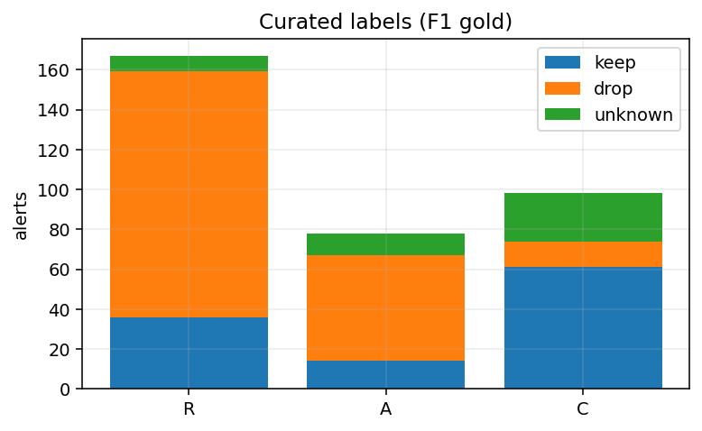

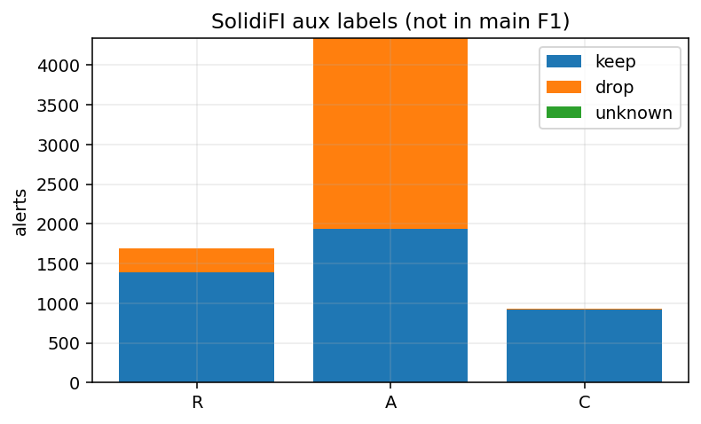

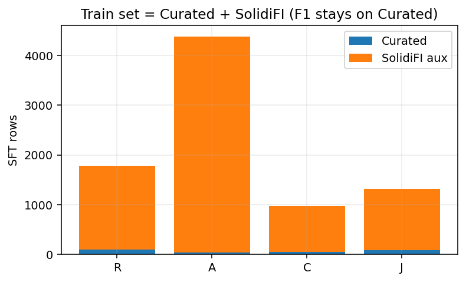

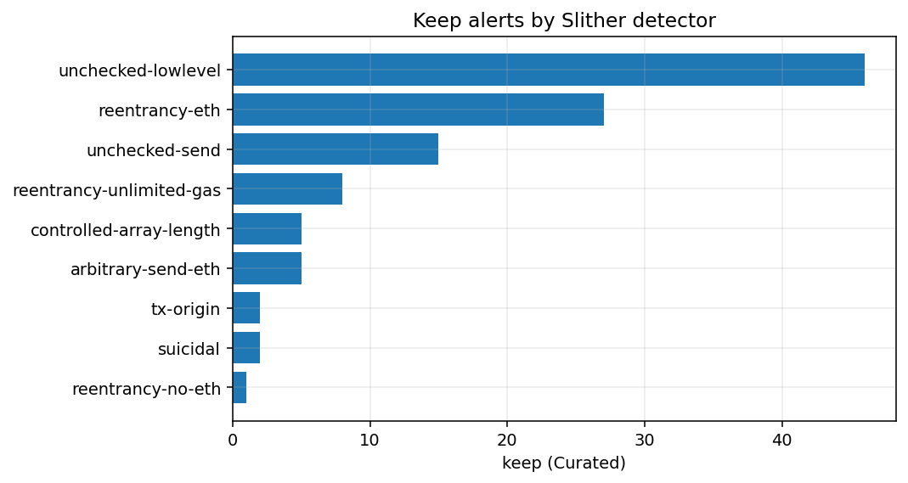

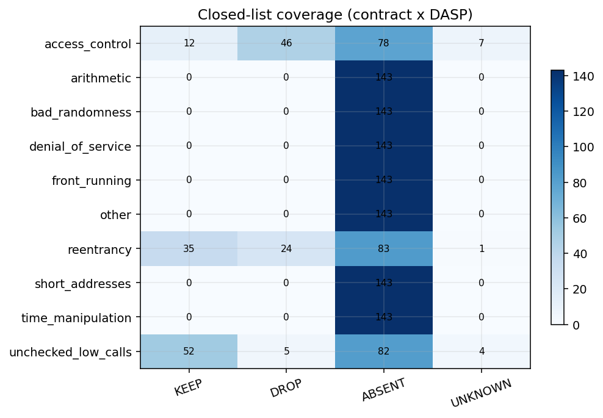

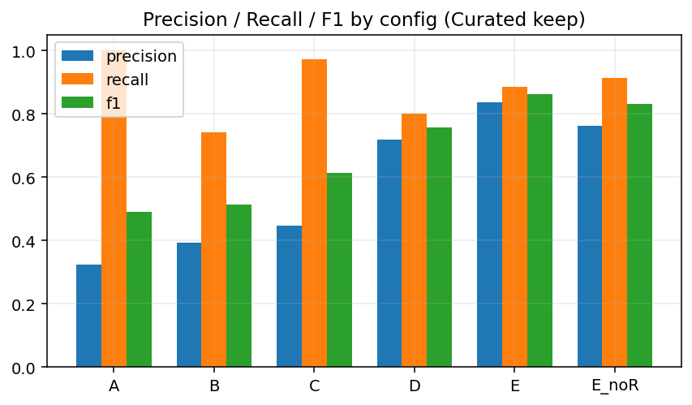

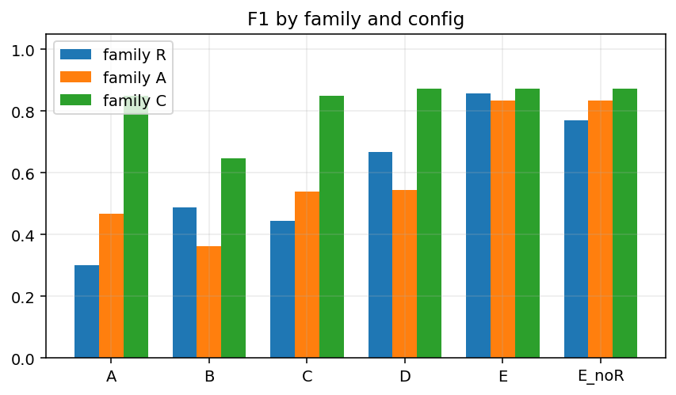

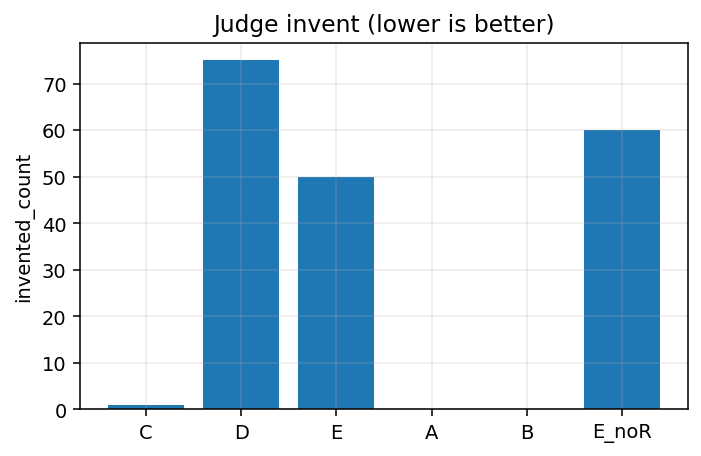

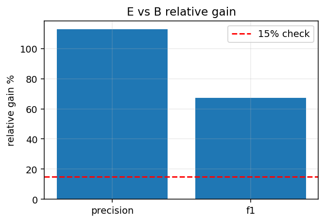

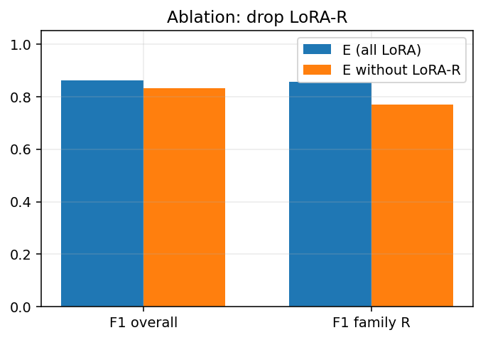

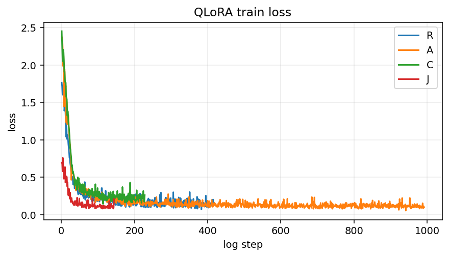

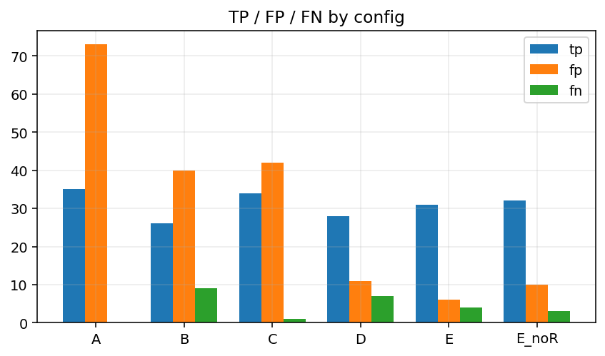

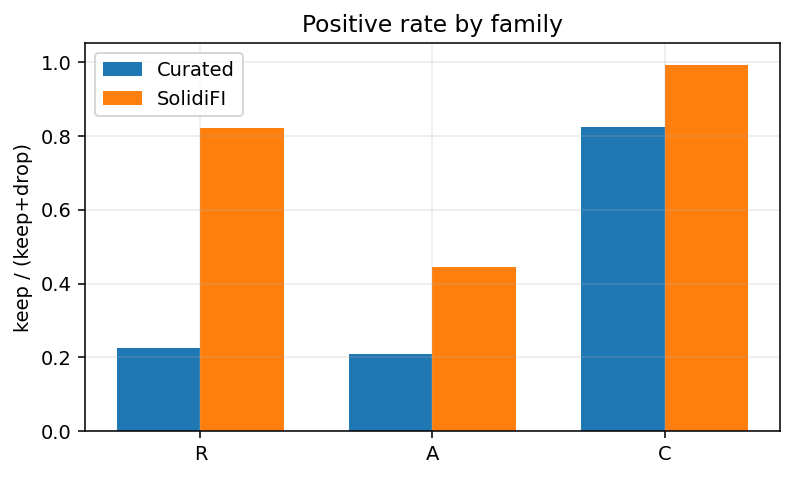

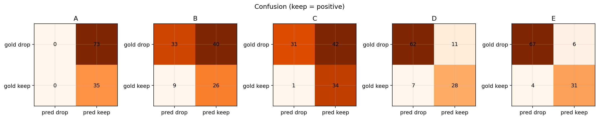

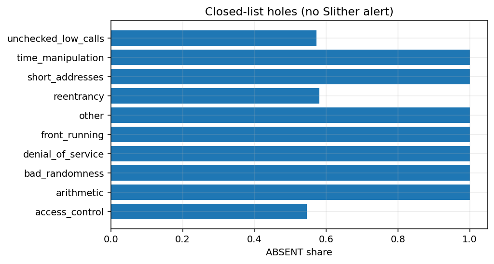

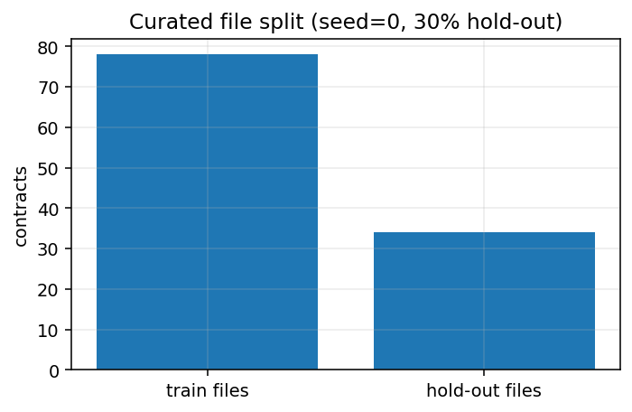

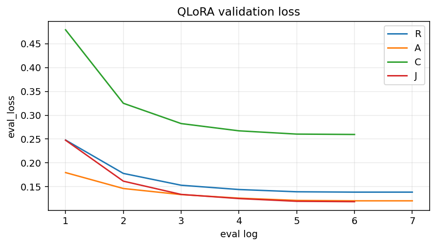

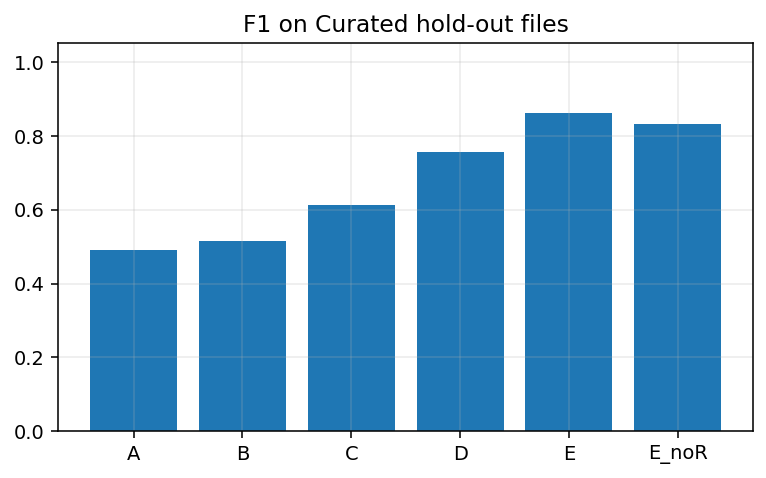

